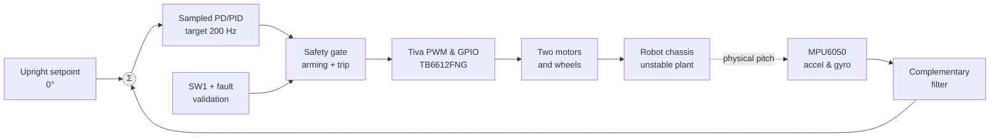
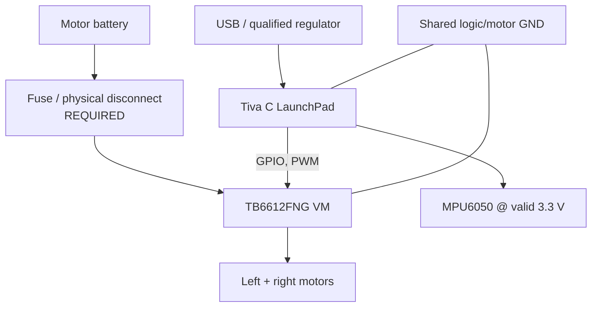
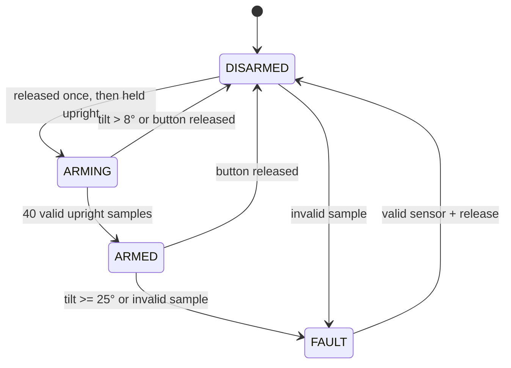

# Tiva C Self-Balancing Robot
### NANENG 512 · Digital Control · Embedded Systems · Inverted Pendulum

[](https://github.com/3more102/Tiva-Self-Balancing-Robot/actions/workflows/host-tests.yml)


> **A reproducible engineering starting point, not a finished self-balancing robot.**  
> This repository contains Tiva C firmware *source*, host-tested control algorithms, stationary gyro-calibration and clock diagnostics, MATLAB **illustrative** analysis, a separate theoretical pitch-only simulator, editable Mermaid engineering diagrams and academic reports. The embedded firmware has **not** been built on or tested with the physical Tiva board; no successful balancing experiment is claimed.

**Assignment exception:** The provided NANENG 512 brief specifically requests **Arduino** for Stage 3. We intend to use **TI Tiva C** instead. Written instructor approval is required before submission.

## Overview

A two-wheel robot behaves approximately like an inverted pendulum: without correcting motion, small pitch deviations grow. The robot estimates pitch from an **MPU6050 accelerometer/gyroscope**, applies a sampled **PD/PID** algorithm on **TM4C123GH6PM** and sends direction/PWM signals to a **TB6612FNG** motor driver. A dedicated software arming state machine prevents actuation until upright orientation and operator switch conditions are met.

### Functional control diagram



**Explore the engineering diagrams:** [Complete hardware/system diagrams](docs/architecture.md) · [Control theory and formulas](docs/control_theory.md) · [Wiring / pinout](hardware/wiring.md) · [Selection and power budget](docs/component_selection.md)

## Hardware platform and architecture

| Item | Planned component | Reason / caveat |
|---|---|---|
| Microcontroller | **TI EK-TM4C123GXL**, TM4C123GH6PM | 80 MHz Cortex-M4F; I²C, PWM, GPIO and onboard SW1 |
| IMU | MPU6050 module | Three-axis acceleration and angular rate; verify real breakout's voltage and mounting |
| Motor driver | TB6612FNG dual H-bridge | Independent direction/PWM; **verify motor stall current** |
| Actuation | Two brushed DC geared motors | Exact gear ratio, torque and current **TBD** |
| Structure | Two wheels + supported vertical chassis | Mass, inertia, wheel radius and COM **TBD** |
| Supply | Battery, regulator, fuse and accessible motor cutoff | Values and schematic **TBD**; never power motors from MCU pins |

**Planned signal map:** I²C0: PB2/PB3; PWM: PB6/PB7; motor direction: PC4–PC7; driver STBY: PA5; SW1: PF4. Board-specific shared pins and voltage warnings are detailed in [hardware/wiring.md](hardware/wiring.md).



This is an **illustrative block diagram, not the electrical schematic** required by the assignment. A fully reviewed schematic, chassis CAD and current-rated parts are outstanding.

## Firmware features and **safety boundaries**

- Complementary pitch estimator: `atan2(ay,az)` plus bias-corrected gyro integration (angular units: degrees and deg/s).
- Nominal loop target: **200 Hz (5 ms)**; PWM: **20 kHz**. Timer1A downcounter now supplies elapsed per-cycle `dt` and software rejects cycles outside the provisional 2.5–8 ms range. **Real timing/jitter are not measured on hardware**.
- PD/PID controller with conditional anti-windup and normalized output clamp `|u| ≤ 0.7`; gains are **not tuned for a physical robot**.
- **Stationary gyro calibration:** 200 consecutive upright/released-switch samples, ±6° pitch, magnitude checks, 0.75 deg/s provisional gyro noise bound and Welford mean/variance accumulation. Calibration attempts time out into disabled state.
- Guard conditions on invalid sensor readings and invalid measured update intervals, including missed-sample faults.
- **Release-to-arm** logic: observe switch release; require 40 consecutive upright sample checks (≤8°) with switch held, then allow the software command gate.
- **Trip:** ≥25° pitch, sensor failure or invalid calculation -> disable the driver; fault requires release before rearming. A fatal I²C failure is latched until hardware reset.
- **Compile-time actuator interlock**: `MOTOR_OUTPUT_ALLOWED 0` is the default in `firmware/tiva/src/main.c`. Motor driver STBY remains LOW; code alone does **not** replace a motor-battery fuse, power switch or hardware cutoff.



**Safety and timing review:** [Firmware verification plan](docs/verification_plan.md) · [Calibration + Timer1 diagrams](docs/calibration_timing.md) · [Optimizations + engineering gaps](docs/optimization_and_design_review.md)

## Getting started

### 1. Run the portable unit tests (PC; no board required)

Prerequisites: a C11 compiler such as GCC or Clang. In repository root:

```bash
gcc -std=c11 -Wall -Wextra -Werror -pedantic \
    -Ifirmware/tiva/include \
    firmware/tiva/src/controller.c tests/test_controller.c \
    -lm -o test_controller
./test_controller
```

Run the additional portable diagnostic tests:

```bash
gcc -std=c11 -Wall -Wextra -Werror -pedantic \
    -Ifirmware/tiva/include \
    firmware/tiva/src/diagnostics.c tests/test_diagnostics.c \
    -lm -o test_diagnostics
./test_diagnostics
python3 -m unittest discover -s tests -p 'test_simulation.py'
```

GitHub Actions also runs these **host-side** checks after pushes and pull requests. Their success **does not establish a working Tiva firmware build or safe motor actuation**.

### 2. Prepare TI Code Composer Studio / TivaWare

1. Install TI [Code Composer Studio](https://www.ti.com/tool/CCSTUDIO) and [EK-TM4C123GXL board resources / TivaWare](https://www.ti.com/tool/EK-TM4C123GXL).
2. Start from a **working TivaWare example** for the exact `TM4C123GH6PM` target to obtain the correct startup file, linker configuration, compiler options and driverlib link library.
3. Add `firmware/tiva/src/main.c`, `controller.c` and `diagnostics.c`, include `firmware/tiva/include`, and configure TI TivaWare library/include paths.
4. Build and test with **motors unpowered**, confirming sensor reads, GPIO voltage, clock, real timing and pin multiplexing.
5. Do **not** enable `MOTOR_OUTPUT_ALLOWED` until the independent physical wiring/current/polarity review is completed.

See [firmware setup and limitations](firmware/tiva/README.md) and [test plan](docs/verification_plan.md). The repository does **not** yet contain a validated, import-ready CCS project.

### 3. Study the MATLAB model (not experimental results)

Run `matlab/model_and_design.m` with MATLAB Control System Toolbox. For a separate **theoretical virtual PD vs open-loop** comparison, run `matlab/pd_theoretical_comparison.m` (base MATLAB; also not a hardware experiment). It constructs a simplified **pitch-only inverted-pendulum** state-space model, applies 5 ms zero-order-hold discretization and demonstrates **LQR**. The model's masses, inertia, friction and torque gain are **placeholder values**. The current MCU code uses **PD/PID, not LQR**.

Only use `matlab/plot_telemetry.m` with an actual measured log carrying `data_origin=MEASURED_TIVA_ROBOT`. It intentionally refuses theoretical traces. **No real telemetry is provided yet.**

### 4. Reproduce the theoretical pitch-only model

```bash
python3 simulation/run_pitch_sim.py --angle 4 --output outputs/PD_THEORETICAL.csv
python3 simulation/run_pitch_sim.py --angle 4 --open-loop --output outputs/OPEN_LOOP_THEORETICAL.csv
```

This generates **simulation-only** CSVs and JSON summary using an idealized pitch plant and *different*, virtual controller gains; it is not proof that the Tiva robot balances. See [simulation design and limitations](simulation/README.md) and [experimental data protocol](docs/experimental_protocol.md).

## Repository contents

```text
Tiva-Self-Balancing-Robot/
├── README.md
├── firmware/tiva/
│   ├── include/controller.h              # control/safety interfaces
│   ├── include/diagnostics.h             # calibration + timing interfaces
│   ├── src/controller.c                  # estimator, PID and safety machine
│   ├── src/diagnostics.c                 # stationary gyro calibration / timing
│   ├── src/main.c                        # TivaWare 200 Hz application
│   ├── src/imu_backend.h                 # MPU6050 I2C functions
│   ├── src/motor_backend.h               # TB6612FNG direction / PWM / STBY
│   └── README.md                         # CCS and device setup
├── simulation/
│   ├── run_pitch_sim.py                  # theoretical-only RK4 simulator
│   └── README.md
├── matlab/
│   ├── model_and_design.m                # illustrative continuous/discrete model
│   ├── pd_theoretical_comparison.m       # virtual PD/open-loop MATLAB study
│   └── plot_telemetry.m                  # plot *measured* CSV once available
├── hardware/
│   ├── wiring.md                         # connection assumptions / precautions
│   └── bom.csv                           # priced quotations still TBD
├── docs/
│   ├── architecture.md                   # system/control/power/safety diagrams
│   ├── control_theory.md                 # equations, assumptions, modeling plan
│   ├── calibration_timing.md             # boot sequence and deadline diagrams
│   ├── experimental_protocol.md          # separate measured vs simulated data
│   ├── component_selection.md            # motor/driver/supply worksheet
│   ├── optimization_and_design_review.md # implemented vs planned work
│   ├── verification_plan.md             # before-power-on / bench criteria
│   ├── assignment_checklist.md           # official submission requirements
│   └── reports/
│       ├── STAGE1_architecture_report.md
│       ├── STAGE2_modeling_report.md
│       └── STAGE3_final_report.md
├── tests/test_controller.c               # host-side estimator/PID/safety tests
├── tests/test_diagnostics.c              # calibration & timer-wrap tests
├── tests/test_simulation.py              # theoretical model assertions
├── .github/workflows/host-tests.yml
└── tools/publish_github.ps1
```

## Coursework deliverables and progress

| Stage | Official deadline | Work expected | Progress |
|---|---|---|---|
| **1** — concept & design | **4 Nov 2026** | Survey, function block diagram, complete schematic, priced BOM, optional CAD, report | Detailed **draft report/diagrams**; formal schematic, survey, actual quotations and CAD missing |
| **2** — model & assembly | **6 Dec 2026** | Assemble robot, mathematical identification/model, MATLAB analysis, report | Preliminary illustrative MATLAB; no assembled or identified system |
| **3** — digital control | **27 Dec 2026** | MATLAB digital-controller design, Arduino implementation per brief (or approved Tiva alternative), complete code/report/presentation | Tiva source and host tests only; target build/validation pending |

**Open the reports:** [Stage 1 — architecture](docs/reports/STAGE1_architecture_report.md) · [Stage 2 — modeling](docs/reports/STAGE2_modeling_report.md) · [Stage 3 — final](docs/reports/STAGE3_final_report.md)

## What can be claimed today?

**Implemented in source:** portable C pitch estimator, guarded PD/PID, safety state machine, gyro calibration, Timer1 elapsed-period guard, theoretical RK4 simulator, Tiva peripheral draft, documentation and tests.  
**Verified:** host-side regression tests and deterministic simulation checks, based on GitHub Actions when green.  
**Not verified:** CCS/TivaWare compilation, board wiring or motor behavior, actual stationary IMU calibration, sampling timing, assembled robot, balancing, physical protection, measured telemetry and hardware performance.

## References

1. [Texas Instruments, EK-TM4C123GXL and TivaWare resources](https://www.ti.com/tool/EK-TM4C123GXL)
2. [TI, TM4C123GH6PM datasheet](https://www.ti.com/lit/ds/symlink/tm4c123gh6pm.pdf)
3. [TI, EK-TM4C123GXL user manual](https://www.ti.com/lit/ug/spmu296/spmu296.pdf)
4. [TDK InvenSense, MPU-6000/MPU-6050 Register Map and Descriptions](https://invensense.tdk.com/wp-content/uploads/2015/02/MPU-6000-Register-Map1.pdf)
5. [Toshiba, TB6612FNG motor driver](https://toshiba.semicon-storage.com/eu/semiconductor/product/motor-driver-ics/brushed-dc-motor-driver-ics/detail.TB6612FNG.html)

**License:** no project license has been selected; please add one before inviting unrestricted reuse. Credit any third-party example startup files or imported material according to their licenses.
