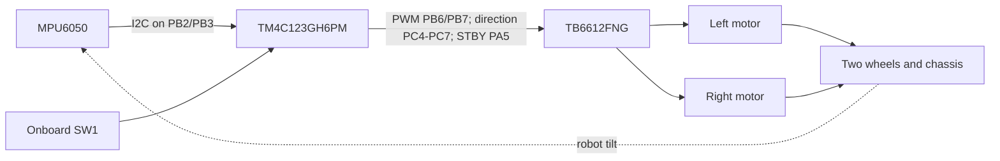

# NANENG 512 — Tiva C Self-Balancing Robot

**Engineering starter project — NOT yet tested on Tiva hardware.**

Two-wheel inverted-pendulum robot using the **TI EK-TM4C123GXL LaunchPad (TM4C123GH6PM)**, an **MPU6050** IMU, two DC geared motors and a **TB6612FNG** dual motor driver. The intended embedded control loop runs at 200 Hz and combines a complementary pitch estimator and PID/PD balance controller. The MATLAB model illustrates discrete control-system analysis, not measured system identification.

> **Course requirement:** The supplied NANENG 512 assignment explicitly requires Arduino in Stage 3. Substituting Tiva C requires instructor approval.

## Current engineering status

| Workstream | Status |
|---|---|
| TivaWare MCU driver code | Draft only; not compiled in CCS |
| Sensor estimation + guarded PID | Portable C implementation and host unit tests |
| Wiring and component list | Provisional; verify the purchased boards |
| MATLAB model | Illustrative; parameters not identified experimentally |
| Robot mechanical assembly, electrical checks, balancing | Not started |
| Measured model, report, presentation | Pending |

## System overview



## Repository structure

- `firmware/tiva/src/main.c`: Embedded TivaWare application. **`MOTOR_OUTPUT_ALLOWED 0` is the default**, so motors cannot be driven until specifically enabled after safe testing.
- `firmware/tiva/src/controller.c` and `firmware/tiva/include/controller.h`: Sensor fusion and pitch PID/PD.
- `firmware/tiva/README.md`: TI Code Composer Studio integration instructions.
- `hardware/wiring.md` and `hardware/bom.csv`: provisional electrical pins, power-safety notes and research BOM.
- `matlab/model_and_design.m`: illustrative state-space, sample-and-hold discretization, LQR response.
- `matlab/plot_telemetry.m`: plot real measured CSV data when logging exists.
- `tests/test_controller.c` and `.github/workflows/host-tests.yml`: portable C tests and GitHub Actions.
- `docs/assignment_checklist.md`, `docs/stage1_report_template.md` and `docs/verification_plan.md`: deliverables and test planning.

## Development and tests

Install TI Code Composer Studio and TivaWare for TM4C123GH6PM. Use the correct MCU startup/linker files (for example, from the official EK-TM4C123GXL TivaWare blinky project) and add this project's C sources; the archive does **not** supply a preconfigured CCS project.

For portable tests on a computer:

```sh
gcc -std=c11 -Wall -Wextra -Werror -pedantic -Ifirmware/tiva/include firmware/tiva/src/controller.c tests/test_controller.c -lm -o test_controller
./test_controller
```

These tests **do not** qualify the motor control firmware on hardware. Begin with disconnected motors, confirm the MPU6050 orientation and gyro bias, and test each output only with restrained wheels and a physical motor power cutoff. The feedback polarity and placeholder controller gains must be identified and verified before any closed-loop balancing attempt.

## Assignment stages

- **Stage 1 — 4 November 2026:** literature survey, function block diagram, final schematic, priced components, optional CAD and report.
- **Stage 2 — 6 December 2026:** assembled robot, mathematical model or identification, MATLAB analysis and report.
- **Stage 3 — 27 December 2026:** digital controller designed using MATLAB and implemented on the approved microcontroller, complete code, final report and presentation.

## References

- [TM4C123GH6PM datasheet](https://www.ti.com/lit/ds/symlink/tm4c123gh6pm.pdf)
- [EK-TM4C123GXL user guide](https://www.ti.com/lit/ug/spmu296/spmu296.pdf)
- [TivaWare and board resources](https://www.ti.com/tool/EK-TM4C123GXL)
- [MPU6050 register map](https://invensense.tdk.com/wp-content/uploads/2015/02/MPU-6000-Register-Map1.pdf)
- [TB6612FNG datasheet](https://toshiba.semicon-storage.com/info/TB6612FNG_datasheet_en_20141001.pdf?did=10660&prodName=TB6612FNG)
