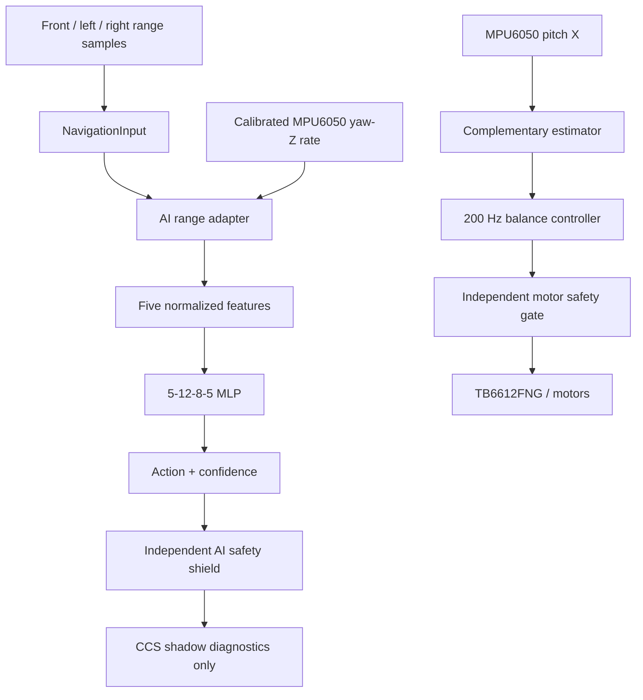

# GyroGuard TinyML — architecture and verification boundary

## System placement

The neural network is a shadow navigation decision layer. It does not replace
the balance PID, does not supersede the rule-based navigation safety policy,
and never writes motor GPIO/PWM directly.

The 200 Hz balance loop remains highest priority. Startup calibration estimates
both pitch-X and vertical/yaw-Z gyro offsets. The corrected yaw rate is passed
to `ai_range_adapter.c`, which maps the existing `NavigationInput` contract
into the AI model's `AiSensorFrame`. The main loop runs inference at 50 Hz
**after issuing the balance command** whenever the balance state is armed. The
AI frame's `inference_enabled` gate is separate from
`NavigationInput.autonomy_enabled`: the rule-based navigation actuator gate
can remain disabled while the model evaluates sensor data in shadow mode. AI
action, confidence and safety override are exposed as CCS watch variables only.

The AI output is not connected to the balance target, differential motor
mixer, PWM or GPIO. `MOTOR_OUTPUT_ALLOWED` remains `0`.

## Range-acquisition contract

The canonical range layer consists of:

- `range_capture.c`: portable non-blocking ECHO pulse state machine.
- `range_scanner.c`: sequential front/left/right scheduler.
- `range_navigation.c`: scanner-to-`NavigationInput` adapter.
- `range_acquisition.c`: foreground coordinator using mockable hardware
  callbacks for timer ticks, ECHO interrupt masking and short TRIG pulses.

These modules are host-tested but are **not yet wired into `main.c` or a
TivaWare hardware backend**. The current `navigation_input` in `main.c`
starts with invalid range samples and `autonomy_enabled=false`, so the
rule-based navigation policy cannot authorize travel. The AI inference gate
is tied to the balance-armed state, independently, but invalid front data
still forces its safety shield to return STOP. It has not evaluated live
sensor data.

The current range capture engine consumes timestamped edge events; a final
TM4C hardware backend must be implemented and verified. The candidate
GPTM CCP pin map and current GPIO-interrupt limitations are documented in
[range-sensing design](range_scanner.md) and [hardware wiring](../hardware/wiring.md).
Do not treat host callback tests as proof of hardware capture or sensor accuracy.

## Network specification

| Layer | Width | Operation |
|---|---:|---|
| Input | 5 | Normalized sensor features |
| Hidden 1 | 12 | Dense + ReLU |
| Hidden 2 | 8 | Dense + ReLU |
| Output | 5 | Dense + softmax |

There are 221 trainable parameters (884 bytes of float32 weights). Inference
uses fixed-size stack arrays and no dynamic allocation. Softmax uses a
max-subtracted exponent to avoid overflow. The model is exported as a C header;
the MCU does not need NumPy or a machine-learning runtime.

### Input order

| Index | Feature | Raw unit | Normalization |
|---:|---|---|---|
| 0 | Front range | mm | clamp(distance / 2000, 0, 1) |
| 1 | Left range | mm | clamp(distance / 2000, 0, 1) |
| 2 | Right range | mm | clamp(distance / 2000, 0, 1) |
| 3 | Front closing speed | m/s | clamp(speed / 2, -1, 1); positive means approaching |
| 4 | Robot yaw rate | deg/s | clamp(rate / 180, -1, 1) |

The yaw-rate input is the MPU6050 gyro-Z axis under the documented sensor
orientation. Verify physical mounting and axis signs before use.

## AI decision safety shield

- Front data must be valid, nonzero, and no older than 250 ms.
- Side data must be valid, nonzero, and no older than 750 ms to authorize a turn.
- FORWARD is rejected if front distance is below 500 mm.
- TURN_LEFT is rejected unless left clearance is at least 500 mm.
- TURN_RIGHT is rejected unless right clearance is at least 500 mm.
- Missing/stale front data, invalid yaw rate, invalid model output or
  insufficient model confidence produces a stopped/reassessment decision.
- The rule-based navigation policy and hardware motor safety gate remain
  independent of the AI output.

All distance and timing thresholds are provisional. Set them from measured
sensor latency, robot speed, braking distance, geometry and motor response
before any floor test.

## Training method and honest model claims

The checked-in MLP was trained by supervised behavior cloning. A synthetic
scenario generator samples open passages, approaching obstacles, narrow
corridors and asymmetric clearances. A deterministic conservative expert
policy supplies labels. Training and validation use separate random seeds.

The recorded validation accuracy (90.93%) is only accuracy against held-out
synthetic examples from that same expert policy. It is not physical navigation
accuracy and does not establish collision avoidance. No real robot dataset has
been collected in this repository.

The training script now reports a labeled confusion matrix, per-class
precision/recall/F1/support, macro metrics and support-weighted F1. The
checked-in metrics JSON predates the expanded schema and must be regenerated
by rerunning the training command.

## Host verification

- `tests/test_ai_navigation.c`: inference probabilities, action decisions,
  confidence handling and safety-shield behavior.
- `tests/test_ai_range_adapter.c`: field mapping, invalid-range preservation,
  timestamp transfer and independent autonomy-enable behavior.
- `tests/test_ai_dataset.py` and `tests/test_ai_training_metrics.py`:
  deterministic dataset and classification-metric validation.
- GitHub Actions runs the model training smoke test.

These checks do not compile the complete TivaWare application or verify real
sensor timing, physical balancing or obstacle-avoidance performance.
