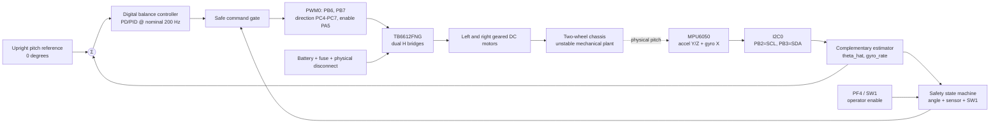
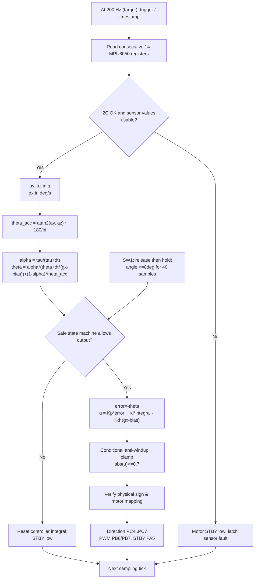
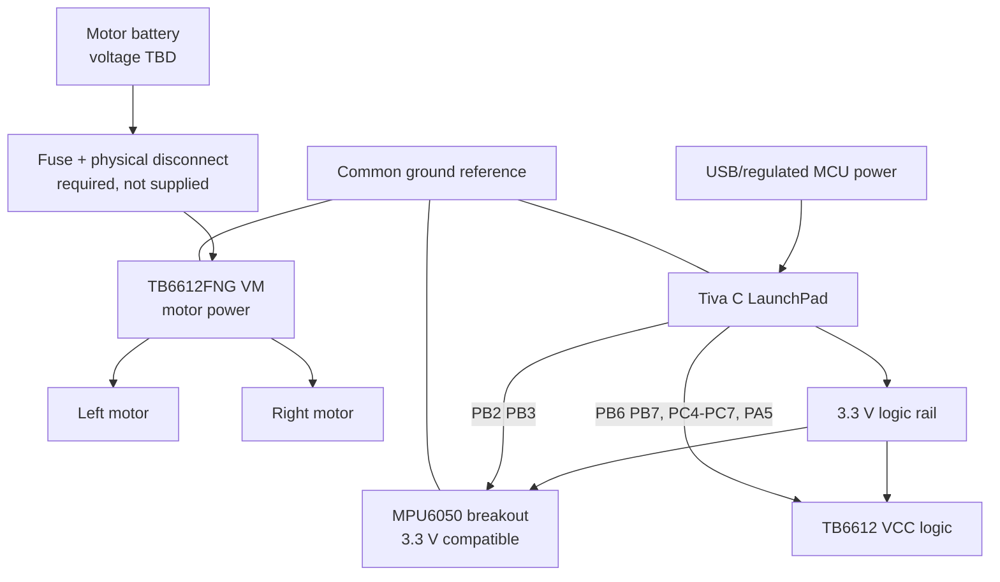
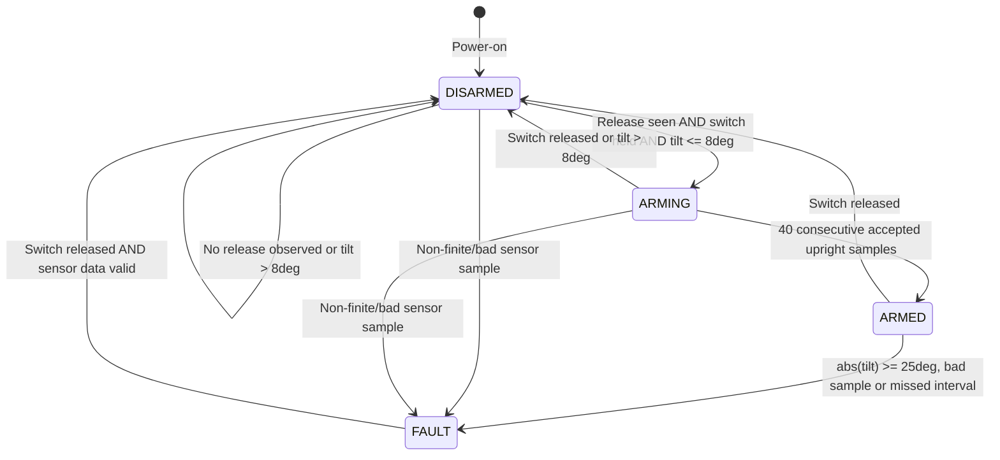
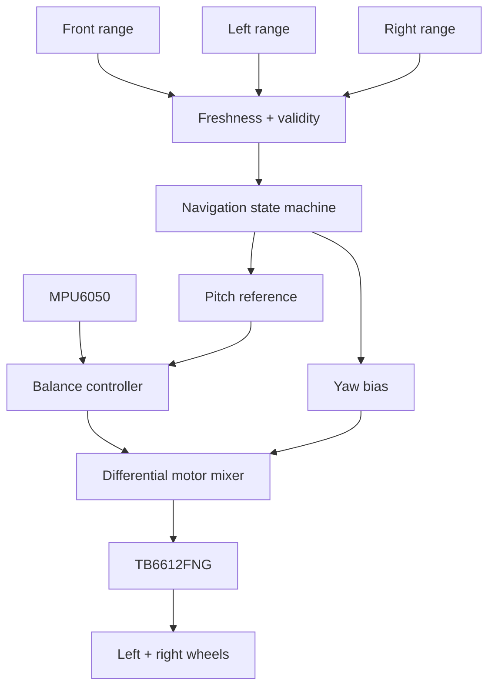

# Engineering architecture and block diagrams

**Status:** preliminary design, not an as-built schematic. Written for the NANENG 512 assignment, using the TM4C123GH6PM in place of Arduino **only if the instructor approves**. All signals, supply domains, polarity and motor specifications must be checked against the hardware actually purchased.

## 1. Functional block diagram

**Why these blocks?** Pitch is inferred from the rate gyro and gravity component of acceleration; a discrete controller computes a normalized motor command, but the safety gate can always force zero output. The battery/driver controls motor energy; MCU GPIO never directly supplies motor current.

## 2. Control-loop signal-flow diagram

The firmware computes `dt` using a Timer1A downcounter and detects some early/late control intervals against provisional 2.5–8 ms bounds. WDOG0 is also configured in source with a 50 ms first timeout and reset on the second uncleared timeout; it is serviced by foreground code, but has not been target-tested and shares the system clock. Actual timing/jitter and worst-case execution time remain unmeasured. Firmware motor output remains compile-time disabled. This diagram is conceptual, not proof of safe real-time timing.

## 3. Power and interconnection diagram

**Warning:** This is a functional wiring diagram, **not** a circuit schematic, PCB layout or complete electrical design. Grounding, decoupling, current paths, regulators, protection, proper driver connections and motor polarity must be drawn and verified before power-on.

## 4. Safety / arming state diagram

`imu_ok=false` is independently latched at application level; for a communication failure, hardware reset is required. WDOG0 supervision is implemented in source but still needs a target fault-injection test; it is system-clocked and does not replace a physical power disconnect. SW1 debouncing and independent-clock supervision remain unimplemented.

## 5. Proposed electrical mapping

| Tiva pin | Signal | Destination | Direction | Important condition |
|---|---|---|---|---|
| PB2 | I2C0SCL | MPU6050 SCL | output | correct 3.3 V pull-up |
| PB3 | I2C0SDA | MPU6050 SDA | bidirectional | correct 3.3 V pull-up |
| PB6 | M0PWM0 | TB6612 PWMA | output | shares board link with PD0 |
| PB7 | M0PWM1 | TB6612 PWMB | output | shares board link with PD1 |
| PC4 / PC5 | AIN1 / AIN2 | Driver motor A | output | check forward polarity |
| PC6 / PC7 | BIN1 / BIN2 | Driver motor B | output | check forward polarity |
| PA5 | STBY | Driver standby | output | **LOW by default** |
| PF4 | SW1 | Onboard push-button | input | active-low; hold-to-enable |
| PF1 / PF2 / PF3 | RGB LEDs | Onboard LEDs | output | error / standby / enabled indication |

Compare with [hardware/wiring.md](../hardware/wiring.md) and the [EK-TM4C123GXL manual](https://www.ti.com/lit/ug/spmu296/spmu296.pdf).

## 6. Data and requirements traceability

| Requirement | Design element | Evidence available | Still missing |
|---|---|---|---|
| Sensor orientation | MPU6050 accel + gyro; complementary filter | Portable C source and host tests | I2C waveform/real sensor log |
| Closed-loop balance | PID + TB6612 PWM | Algorithm source | Actual motor sign/gains and repeatable tests |
| Safety | STBY low, off switch, trip angle, arming state machine | Static code + host tests | End-to-end physical cutoff timing |
| Control analysis | MATLAB linear model and nominal 200 Hz discretization | MATLAB script | Validated physical parameters / log data |
| Stage 1 architecture | These Mermaid diagrams, pin map, component responsibilities | This document | Reviewed electrical schematic |
| Mechanical integration | Two-wheel chassis model | Concept | CAD, dimensions, center of mass |

## 7. Obstacle-avoidance extension

The portable navigation policy is an outer motion-request layer. It consumes timestamped front/left/right range samples and returns a pitch target and differential yaw bias. The 200 Hz balance controller remains the inner loop and retains authority over the motor command.

See [obstacle avoidance design and verification](obstacle_avoidance.md) for thresholds, state transitions and limitations. The software policy is host-tested, but there is not yet a TivaWare range-sensor driver, confirmed sensor pinout or integration in main.c. The policy's timed turn and lean requests are open-loop because wheel encoders are not currently part of the hardware design.

