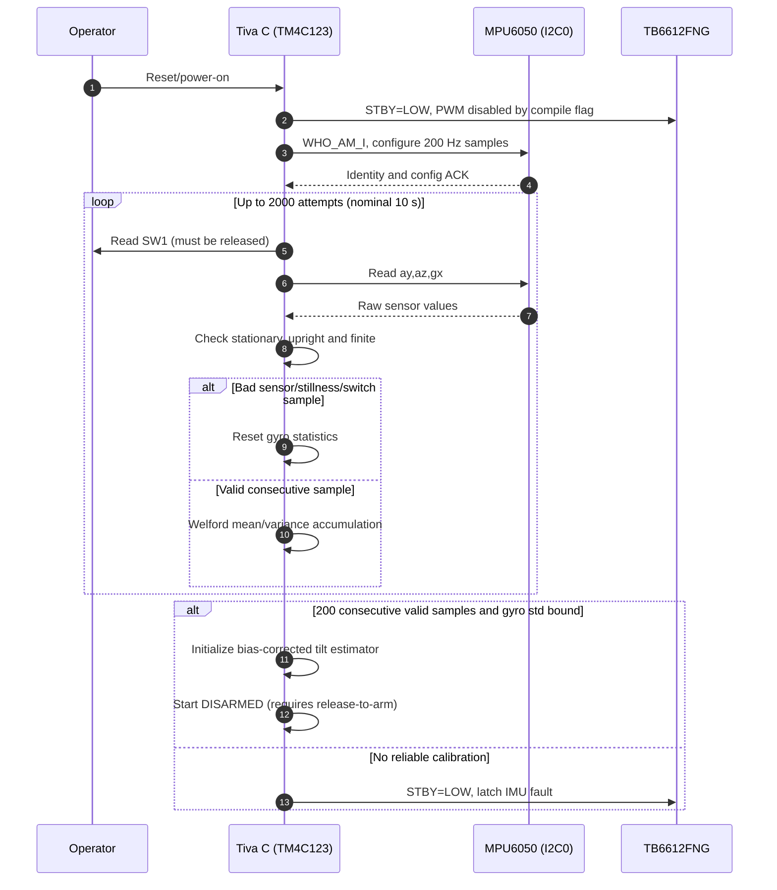
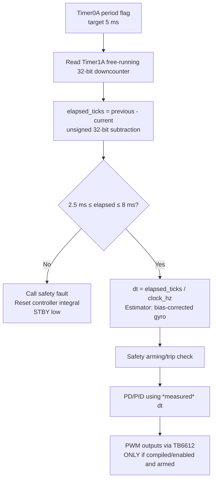
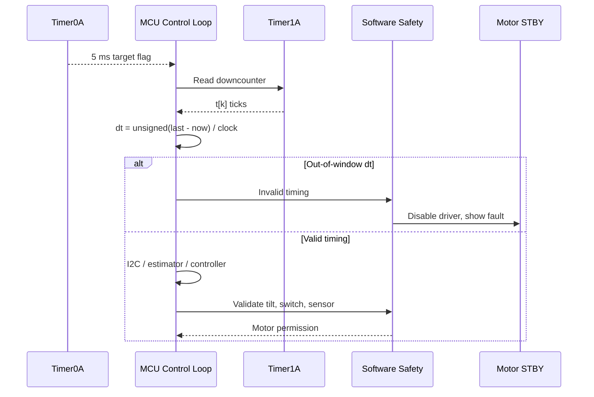

# Sensor Calibration, Loop Timing and Fault Containment

**Status:** algorithms and host tests are implemented. The actual Tiva image has **not** been compiled or validated on a LaunchPad. The time and stillness thresholds are provisional, to be accepted/rejected by real sensor data.

## 1. Boot and calibration sequence

### Acceptance predicates (preliminary)

A calibration sample counts only if all hold:

- Operator SW1 is **released**, so button is not requesting arming.
- Accelerometer Y/Z and X gyro values are finite.
- Norm of the YZ acceleration projection is within `1.00 ± 0.15 g`. Because X-axis acceleration is omitted, this is only useful for a physically well-aligned pitch sensor frame.
- The pitch derived from `atan2(ay, az)` is within `±6 degrees`.
- The magnitude of X gyro rate is at most `5 degrees/second`.
- 200 consecutive accepted samples are collected and the estimated sample standard deviation of X gyro is not above `0.75 degrees/second`.

Each rejected sample restarts the 200-sample sequence. Max 2000 attempts then fatal startup safe state. At 200 Hz this is **nominally** 1 s for a clean 200-sample calibration or up to 10 s for unsuccessful attempts. It is not a guaranteed wall-clock limit without firmware timing validation.

Gyroscope bias estimation uses **Welford's online mean and sample variance** to avoid maintaining a sum of squared rates with poor numerical conditioning. The current code does not estimate accelerometer offset, calibrate all gyro axes, compensate temperature, or verify 3D gravity norm.

## 2. Measured elapsed-time loop

The Timer1A counter is 32-bit periodic. At 80 MHz one full period is approximately `(2^32)/80e6 = 53.687 s`. **The subtraction is valid only when fewer than 2^32 tick counts elapse between sampled reads.** A stalled CPU beyond that time can alias elapsed counts; therefore a **hardware watchdog and motor-power interlock remain required**. Interrupt latency/critical section effects have not been instrumented.

## 3. Software/hardware evidence boundaries

The pure C `diagnostics.c` library and `tests/test_diagnostics.c` test stationary calibration and timer wrap behavior with synthetic data; they **do not** establish that Timer0/Timer1 are configured correctly by target-specific code or that I2C is reliable on an actual robot.

Unresolved electrical/runtime hazards:

- MCU hung inside a blocking I2C/other driver call would stop periodic software updates; no hardware watchdog exists yet.
- Software polling may lose multiple timer events. The measured period detects *some*, but not all, violations.
- Incorrect voltage, wrong sensor axis, failing switch input or motor supply transient is not cured by host tests.
- Sensor temperature drift and acceleration during motor actuation remain uncharacterized.
- The onboard user switch is **not** an independent motor supply emergency cut-off.
- Actuators remain compile-time disabled (`MOTOR_OUTPUT_ALLOWED 0`) until hardware acceptance.

## 4. Source and test traceability

| Requirement | Implementation | Automated regression |
|---|---|---|
| Reject uncalibrated noisy/moving samples | `firmware/tiva/src/diagnostics.c` | `tests/test_diagnostics.c` |
| Estimate 200-sample X gyro bias | Welford accumulation | Alternating symmetric-noise test |
| Reject excessive gyro variance | Sample variance upper bound | Noisy ±2 dps failure test |
| Reject invalid elapsed period | Timer1-based timing guard | zero/oversized and rollover tests |
| Use measured dt in estimator / PID | `firmware/tiva/src/main.c` | Source integration review needed; no MCU execution yet |
| Motor inhibit on fault | `main.c` + `controller.c` safety gate | State-machine host tests, hardware pending |

## 5. Next real-target test procedure

1. Compile/flash for the exact `TM4C123GH6PM` without motor supply connected.
2. Probe PB2/PB3 I2C pull-up voltage, rate, WHO_AM_I and sample sequence; record logic analyzer captures.
3. Calibrate on a fixture at 0°, then intentionally tilt >6° during startup. Confirm calibration does not report success.
4. With a calibrated fixture, scope Timer0A/Timer1-derived sample intervals using a debug GPIO marker and record max, median and missed ticks.
5. Simulate a short and long sampling interval by inducing controlled load in a safe test build; confirm STBY LOW.
6. Check operation after reset while SW1 held, after release, during tipping, and on sensor disconnect. Document whether motor power cutoff remains available if the MCU hangs.
