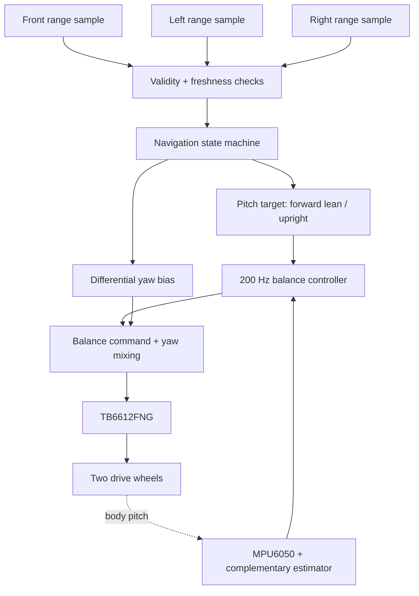

# Obstacle avoidance — software foundation

**Status:** portable navigation policy and host tests are implemented. main.c calls the policy and routes its pitch/yaw requests through the controller/motor-mixing path, but autonomy is disabled and range inputs are invalid placeholders. The TivaWare range-sensor acquisition, physical sensor wiring, operator enable and floor tests are not implemented or verified. Motor output remains disabled by default.

## 1. Intended architecture

The balance controller remains the inner, highest-priority loop. Obstacle avoidance is an outer motion-request layer:



Navigation must never delay, block or replace the balance update. If the front range is invalid or stale, navigation requests zero travel. If neither side has verified clearance, it holds rather than guessing.

## 2. Portable policy contract

The navigation interface is independent of TivaWare. The sensor backend supplies millimetre readings, validity flags and sample timestamps.

| Parameter | Initial software value | Meaning |
|---|---:|---|
| Front stop distance | 350 mm | Stop forward travel at or below this distance |
| Front clear distance | 500 mm | Require this distance for re-entry to cruise |
| Side clear distance | 500 mm | A side must meet this distance before a turn |
| Front sample maximum age | 250 ms | Stale front readings stop travel |
| Side sample maximum age | 750 ms | Stale side readings cannot authorize a turn |
| Turn duration | 350 ms | Provisional open-loop turn duration |
| Clear confirmation | 3 distinct samples | Avoid resuming on one transient echo |
| Maximum turns per obstruction | 2 | Stop retrying if the path remains blocked |
| Cruise lean request | 1.5 degrees | Initial, unvalidated forward pitch target |
| Turn bias | 0.12 normalized | Initial, unvalidated differential command |

These are **software starting values**, not measured stopping distances or safe speeds. The policy rejects zero and values above 4000 mm; change NAV_MAX_RANGE_MM to match the selected sensor datasheet. In particular, timeout sentinels such as 65535 must never be interpreted as clear space. Tune all thresholds only after the sensor geometry, chassis, motors and control loop are measured.

### State behavior

1. **DISABLED:** autonomy is off; pitch and yaw requests are zero.
2. **HOLD:** startup, stale data, obstacle, or uncertain path; travel requests are zero.
3. **CRUISE:** a fresh front sample is clear; request a small pitch target.
4. **TURN_LEFT / TURN_RIGHT:** stop forward lean and request a short differential turn toward a side with verified clearance.
5. **Re-verify:** after a turn, require three new, fresh front samples at or beyond the clear threshold before returning to cruise. If the path remains blocked, at most one additional turn attempt is allowed; otherwise remain stopped.

Positive yaw bias is defined as a left-wheel command greater than the right-wheel command, corresponding to a right turn when the motor directions have been calibrated. The motor mixer must preserve the balance component and scale both wheel commands together if either would exceed the normalized output range.

## 3. Sensor hardware plan

The current repository has no range-sensor driver or confirmed sensor pinout. The policy expects three logical readings: front, left and right.

For the first hardware integration, three fixed range sensors are the simplest software match. Trigger them sequentially, not simultaneously, and allow sufficient quiet time between pings to reduce acoustic cross-talk. A single sensor on a servo is another option, but its scan schedule must still meet the front/side freshness limits and must not block the balance loop.

Before selecting pins, reconcile the LaunchPad header, existing PB2/PB3 I2C pins, PB6/PB7 motor PWM, PC4-PC7 motor direction, PA5 STBY, PF4 SW1 and onboard LED use. Do not copy a pin assignment from an unrelated Tiva board. Confirm the exact range module's supply and Echo output voltage; add a suitable level shifter or divider if the signal exceeds the TM4C GPIO input rating.

## 4. Control integration still required

- Add a non-blocking TivaWare range acquisition backend with timeout, edge timestamps and invalid-sample handling.
- Decide and document the physical sensor arrangement and pin mapping.
- The main application now calls the navigation policy and passes its pitch/yaw requests through the controller and differential motor-mixing path; the input structure remains all-invalid/autonomy-disabled until a real sensor backend and operator enable are added.
- Pass the requested pitch target to the balance controller's target-angle API.
- Mix yaw bias with the balance command using the differential motor interface; calibrate both wheel polarities with wheels raised.
- Keep MOTOR_OUTPUT_ALLOWED set to 0 until the hardware power, polarity, current and emergency-disconnect checks are complete.
- Add measured sensor latency, stop distance, turn angle and repeatability to the experimental log.

There are no wheel encoders or closed-loop velocity estimates in the current design. The initial lean request and timed turn are therefore open-loop motion requests, not regulated speed or precise path planning. The main-loop command path is connected for software integration tests, but the disabled sensor input means no autonomous motion is currently possible. Encoder feedback and measured motor/chassis parameters are future work.

## 5. Host verification

Run from the repository root:

```bash
gcc -std=c11 -O2 -Wall -Wextra -Werror -pedantic \
    -Ifirmware/tiva/include \
    firmware/tiva/src/navigation.c tests/test_navigation.c \
    -lm -o /tmp/test_navigation
/tmp/test_navigation
```

The tests cover autonomy disable, invalid/stale front data, three-sample clear confirmation, turn-side selection, timed turn completion, post-turn re-verification and holding when neither side is clear. These host tests do not verify TivaWare peripherals, sensor wiring, physical stopping distance or real obstacle avoidance.
