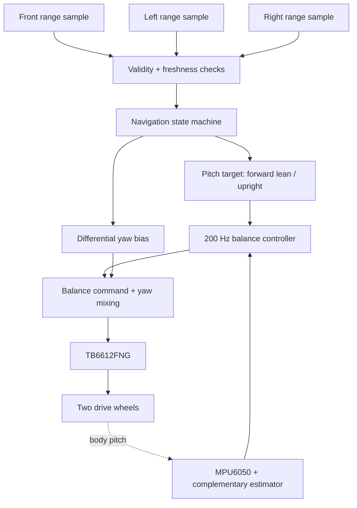

# Obstacle avoidance — software foundation

**Status:** portable navigation policy, ultrasonic echo-capture core, three-sensor round-robin scheduler, scanner-to-navigation adapter, hardware-callback acquisition coordinator and host tests are implemented. main.c calls the navigation policy and routes its pitch/yaw requests through the controller/motor-mixing path, but autonomy is disabled and range inputs are invalid placeholders. The TivaWare GPIO/timer backend, physical sensor wiring, operator enable and floor tests are not implemented or verified. Motor output remains disabled by default.

## 1. Intended architecture

The balance controller remains the inner, highest-priority loop. Obstacle avoidance is an outer motion-request layer:



Navigation must never delay, block or replace the balance update. If the front range is invalid or stale, navigation requests zero travel. If neither side has verified clearance, it holds rather than guessing.

## 2. Portable policy contract

The navigation interface is independent of TivaWare. The sensor backend supplies millimetre readings, validity flags and sample timestamps.

| Parameter | Initial software value | Meaning |
|---|---:|---|
| Front stop distance | 350 mm | Stop forward travel at or below this distance |
| Front clear distance | 500 mm | Require this distance for re-entry to cruise |
| Side clear distance | 500 mm | A side must meet this distance before a turn |
| Maximum accepted range | 4000 mm | Reject zero and out-of-range/timeout sentinel values |
| Front sample maximum age | 250 ms | Stale front readings stop travel |
| Side sample maximum age | 250 ms | Side clearance must remain fresh during a turn |
| Turn duration | 350 ms | Provisional open-loop turn duration |
| Clear confirmation | 3 distinct samples | Avoid resuming on one transient echo |
| Maximum turns per obstruction | 2 | Stop retrying if the path remains blocked |
| Cruise lean request | 1.5 degrees | Initial, unvalidated forward pitch target |
| Balance-controller pitch-target clamp | ±3 degrees | Hard software limit on outer-loop commanded lean; provisional |
| Turn bias | 0.12 normalized | Initial, unvalidated differential command |

These are **software starting values**, not measured stopping distances or safe speeds. The policy rejects zero and values above 4000 mm; change NAV_MAX_RANGE_MM to match the selected sensor datasheet. In particular, timeout sentinels such as 65535 must never be interpreted as clear space. Tune all thresholds only after the sensor geometry, chassis, motors and control loop are measured. The balance controller independently clamps pitch targets to ±3°; the 1.5° cruise request is inside that provisional bound.

### State behavior

1. **DISABLED:** autonomy is off; pitch and yaw requests are zero.
2. **HOLD:** startup, stale data, obstacle, or uncertain path; travel requests are zero.
3. **CRUISE:** a fresh front sample is clear; request a small pitch target.
4. **TURN_LEFT / TURN_RIGHT:** stop forward lean and request a short differential turn toward a side with verified clearance.
5. **Re-verify:** after a turn, require three new, fresh front samples at or beyond the clear threshold before returning to cruise. If the path remains blocked, at most one retry is allowed, and only toward the opposite side with fresh verified clearance; otherwise remain stopped.

Positive yaw bias is defined as a left-wheel command greater than the right-wheel command, corresponding to a right turn when the motor directions have been calibrated. The motor mixer must preserve the balance component and scale both wheel commands together if either would exceed the normalized output range.

## 3. Sensor hardware plan

The repository includes a portable echo-capture engine (`range_capture.c`), a three-sensor round-robin scheduler (`range_scanner.c`), a mapping adapter (`range_navigation.c`) and a hardware-callback coordinator (`range_acquisition.c`) that schedules triggers and forwards timestamped ECHO edges. The scheduler permits one active ping at a time, enforces a configurable quiet interval, publishes valid/invalid distance samples with timestamps and rejects out-of-range results. These portable modules do not configure TivaWare GPIO/timer peripherals, generate physical TRIG pulses or assign pins. The policy expects front, left and right readings.

For the first hardware integration, three fixed range sensors are the simplest software match. Trigger them sequentially, not simultaneously, and allow sufficient quiet time between pings to reduce acoustic cross-talk. A single sensor on a servo is another option, but its scan schedule must still meet the front/side freshness limits and must not block the balance loop.

Before selecting pins, reconcile the LaunchPad header, existing PB2/PB3 I2C pins, PB6/PB7 motor PWM, PC4-PC7 motor direction, PA5 STBY, PF4 SW1 and onboard LED use. Do not copy a pin assignment from an unrelated Tiva board. Confirm the exact range module's supply and Echo output voltage; add a suitable level shifter or divider if the signal exceeds the TM4C GPIO input rating.

## 4. Control integration still required

- [x] Call the navigation policy from `main.c` and route pitch/yaw requests through the target-angle controller and differential motor mixer.
- [x] Add a portable, host-tested echo-capture engine that supports independent sensor instances and timer-tick timestamps.
- [x] Add a portable, host-tested three-sensor round-robin scheduler with quiet-time enforcement, timeout publication and timestamped range samples.
- [x] Add a host-tested adapter that maps scanner samples into `NavigationInput` while preserving the separate autonomy-enable gate.
- [x] Add a host-tested foreground acquisition coordinator with mockable timer, ECHO interrupt-mask and TRIG-pulse callbacks.
- Add the non-blocking TivaWare GPIO/timer backend that implements the acquisition callbacks and physical TRIG/ECHO pin mapping.
- Decide and document the physical sensor arrangement and pin mapping; keep the operator autonomy enable separate from the balance-enable switch.
- Calibrate both wheel polarities with wheels raised before any motor-output qualification.
- Keep MOTOR_OUTPUT_ALLOWED set to 0 until the hardware power, polarity, current and emergency-disconnect checks are complete.
- Add measured sensor latency, stop distance, turn angle and repeatability to the experimental log.

There are no wheel encoders or closed-loop velocity estimates in the current design. The initial lean request and timed turn are therefore open-loop motion requests, not regulated speed or precise path planning. The main-loop command path is connected for software integration tests, but the disabled sensor input means no autonomous motion is currently possible. Encoder feedback and measured motor/chassis parameters are future work.

## 5. Host verification

Run from the repository root:

```bash
gcc -std=c11 -O2 -Wall -Wextra -Werror -pedantic \
    -Ifirmware/tiva/include \
    firmware/tiva/src/navigation.c tests/test_navigation.c \
    -lm -o /tmp/test_navigation
/tmp/test_navigation

gcc -std=c11 -O2 -Wall -Wextra -Werror -pedantic \
    -Ifirmware/tiva/include \
    firmware/tiva/src/range_capture.c firmware/tiva/src/range_scanner.c \
    tests/test_range_scanner.c -o /tmp/test_range_scanner
/tmp/test_range_scanner
```

The navigation tests cover autonomy disable, invalid/stale front data, out-of-range timeout sentinels, three-sample clear confirmation, turn-side selection, timed turn completion, post-turn re-verification, holding when neither side is clear, uint32 timestamp rollover, stale side-sample rejection and opposite-side retry rules. The range-capture tests cover valid/invalid pulse widths, missing and stuck echoes, late edges, timer rollover and distance conversion. The range-scanner tests cover round-robin order, one-active-sensor enforcement, wrong-sensor edge rejection, timeout/invalid publication, range bounds and timer rollover. The range-to-navigation adapter tests verify sample mapping, missing/timeout invalidation and independent autonomy gating. These host tests do not verify TivaWare peripherals, sensor wiring, physical stopping distance or real obstacle avoidance.
