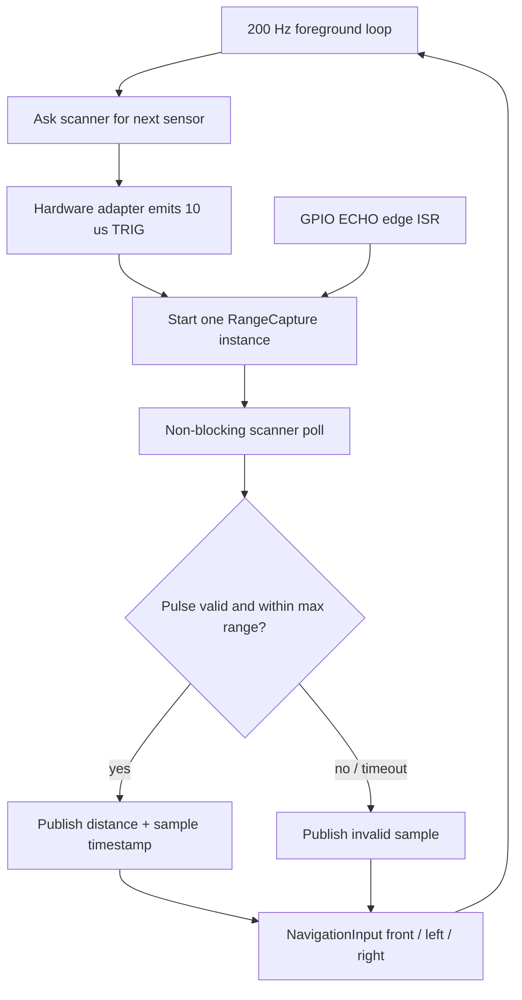

# Three-sensor ultrasonic scanner

**Status:** portable, host-tested round-robin scheduler and scanner-to-navigation input adapter. They are not yet connected to TivaWare GPIO pins or physical sensors.

## Architecture

The navigation policy consumes three logical samples: front, left and right. The range scanner schedules exactly one sensor at a time, forwards only the active sensor's ECHO edges to its own capture state, and publishes a completed sample with a millisecond timestamp.



## API contract

- `range_scanner_next_trigger()` returns the next round-robin sensor only when no capture is active and the configured quiet interval has elapsed.
- `range_scanner_begin()` must be called immediately before the hardware TRIG pulse. It starts that sensor's independent `RangeCapture`.
- The GPIO ISR calls `range_scanner_echo_edge()` with the physical sensor ID and the current up-counting timer timestamp.
- `range_scanner_poll()` is called from the foreground loop. It never waits; on completion it publishes either a valid distance or an invalid sample.
- `range_scanner_get_sample()` copies the most recently published result. `has_sample` distinguishes "not measured yet" from a measured timeout; `valid` distinguishes a usable distance from an invalid reading.
- `range_navigation_build_input()` copies the three latest samples into the exact `NavigationInput` fields used by `navigation_update()`. It keeps the separate autonomy-enable argument independent of sensor validity and maps missing/invalid samples to `valid=false`, `distance_mm=0`.
- The navigation policy, not the scanner adapter, evaluates each sample timestamp against the front/side freshness limits.

The foreground adapter must serialize scanner access with the ECHO ISR. Disable only the active sensor's GPIO interrupt briefly while starting/polling/copying the capture state, then restore it. Do not hold interrupts masked while waiting for an echo.

## Initial timing profile

The profile below is a software starting point for a candidate HC-SR04-compatible module at an 80 MHz timer clock. Confirm the exact module datasheet before hardware use.

| Parameter | Value |
|---|---:|
| Timer frequency | 80 MHz |
| Echo timeout | 25 ms / 2,000,000 ticks |
| Accepted pulse width | 117 us–17.5 ms |
| Minimum interval between any two sensor triggers | 60 ms / 4,800,000 ticks |
| Maximum published distance | 4,000 mm |
| Three-sensor scan period | approximately 180 ms, plus foreground completion latency |

A 60 ms inter-trigger interval is conservative against acoustic cross-talk and keeps a full three-sensor round-robin cycle below the navigation policy's 250 ms sample-age limit under the stated assumptions. Verify actual acoustic behavior and sensor latency on the assembled chassis; increase the quiet interval if cross-talk is observed.

The scanner does not choose GPIO pins, create TRIG pulses, configure NVIC, or enable autonomy. Physical trigger/ECHO mapping and voltage compatibility remain board- and module-specific. A 5 V ECHO output must not be connected directly to a 3.3 V TM4C GPIO; use a verified level-shifting circuit.

## Safety

- Timeout, invalid pulse width, and distances above the configured maximum publish `valid=false` and `distance_mm=0`; never treat no-echo as clear space.
- Only one sensor is active at a time.
- Unsigned elapsed-tick subtraction supports timer rollover when intervals are no greater than 2^31-1 ticks.
- A sample is timestamped when the foreground consumes the completed capture. This timestamp is slightly later than the physical echo; retain the existing conservative freshness limits.
- The navigation policy and scanner do not command motors directly. `MOTOR_OUTPUT_ALLOWED` remains `0` until hardware qualification.

## Host tests

```sh
gcc -std=c11 -O2 -Wall -Wextra -Werror -pedantic \
  -Ifirmware/tiva/include \
  firmware/tiva/src/range_capture.c firmware/tiva/src/range_scanner.c \
  tests/test_range_scanner.c -o /tmp/test_range_scanner
/tmp/test_range_scanner
```

Tests cover round-robin order, one-active-sensor enforcement, wrong-sensor edge rejection, valid/invalid/timeout publication, range bounds, timer rollover and invalid API arguments. `tests/test_range_navigation.c` verifies front/left/right field mapping, missing samples, timeout handling and the independent autonomy-enable gate.

To compile and run the scanner-to-navigation adapter tests:

```sh
gcc -std=c11 -O2 -Wall -Wextra -Werror -pedantic \
  -Ifirmware/tiva/include \
  firmware/tiva/src/navigation.c firmware/tiva/src/range_capture.c \
  firmware/tiva/src/range_scanner.c firmware/tiva/src/range_navigation.c \
  tests/test_range_navigation.c -lm -o /tmp/test_range_navigation
/tmp/test_range_navigation
```
