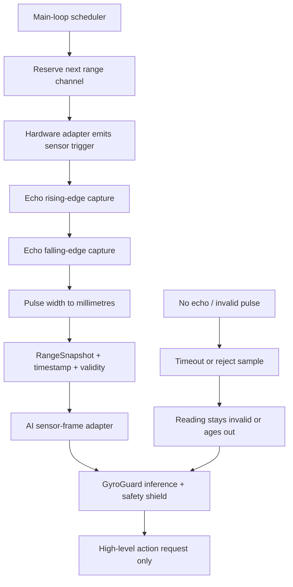

# GyroGuard range-sensing layer

## Purpose and boundary

The portable range-sensing core provides asynchronous capture, timeout handling,
three-sensor scheduling, distance conversion and freshness metadata for the
front/left/right obstacle sensors. It is designed to sit between a TivaWare
GPIO/timer adapter and the existing AiSensorFrame interface.

The portable core does not assume a sensor model, GPIO pin, trigger-pulse
width, timer capture channel or electrical level. An optional target adapter
now exists in `firmware/tiva/src/range_backend.h` for HC-SR04-compatible
trigger/echo modules. It is **disabled by default** because the actual sensor
module has not been confirmed.

## Event flow

## Portable API

- range_array_next_trigger() reserves one channel in round-robin order.
- The caller must immediately emit the hardware-specific trigger pulse.
- The GPIO/timer capture ISR forwards both echo edges to
  range_array_echo_edge().
- range_array_poll() expires a missing rising or falling edge.
- range_array_snapshot() returns front/left/right readings with independent
  freshness limits.
- ai_sensor_frame_from_ranges() maps the snapshot and a separately measured
  yaw rate into the exact input structure consumed by ai_navigation_step().

Only one ultrasonic channel is active at a time to reduce cross-talk.

## Optional TM4C123GXL hardware adapter

The optional `range_backend.h` adapter is selected with
`RANGE_HCSR04_BACKEND_ENABLED`. Its default is `0`; do not change it until
the physical sensor model, wiring and voltage levels are checked.

When enabled, the provisional pin map is:

| Sensor | TRIG | ECHO |
|---|---|---|
| Front | PE0 | PE1 |
| Left | PE2 | PE3 |
| Right | PE4 | PE5 |

The EK-TM4C123GXL LaunchPad manual shows PE0–PE5 on its expansion headers
([TI board manual](https://www.ti.com/lit/ug/spmu296/spmu296.pdf)). The adapter
uses Timer2A to end a 12 µs trigger pulse and Port E GPIO interrupts on both
Echo edges. Timer1A is already configured by `main.c` as a free-running
80 MHz down-counter; the adapter passes its bitwise inverse to the portable
core, with `ticks_per_us = 80`. This avoids a blocking pulse-width polling
loop in the balance task.

**Electrical warning:** many HC-SR04-style modules are powered from 5 V and may
drive Echo to 5 V. The TM4C GPIO must not receive an out-of-spec voltage. Use a
proper divider or level shifter if the exact module's datasheet does not
guarantee a 3.3 V-safe Echo output. Confirm the trigger input recognizes the
Tiva's 3.3 V output. The adapter has not been target-compiled or hardware
tested.

In `main.c`, range acquisition is serviced from the 200 Hz foreground loop.
The AI sensor frame is refreshed and inference runs at 50 Hz in shadow mode.
The action, confidence and safety-override flag are available as CCS watch
variables, but the action is **not** connected to pitch target, yaw mixing or
motor PWM. With the default disabled backend, all range channels remain
invalid and the AI must return STOP.

## Current timing and conversion assumptions

| Parameter | Current default | Meaning |
|---|---:|---|
| Inter-ping gap | 60 ms | Minimum time between any two sensor triggers |
| Three-sensor refresh cycle | about 180 ms | Nominal front/left/right round-robin period |
| Echo timeout | 13,000 µs | Wait limit, with 1 ms margin above the accepted pulse maximum |
| Minimum accepted pulse | 100 µs | Reject implausibly short pulses |
| Maximum accepted pulse | 12,000 µs | Reject late/overlong pulses |
| Maximum model distance | 2,000 mm | Clamp output to the model's supported range |
| Speed of sound | 343 m/s | Fixed 20 °C approximation |

The conversion is:

distance_mm = round(pulse_us * 343 / 2000)

This is a nominal conversion, not calibrated accuracy. Temperature, sensor
geometry, target angle, acoustic cross-talk and module-specific behavior can
change the measurement. Verify against known distances and the selected
sensor's datasheet before relying on it.

The caller supplies raw ticks from one free-running hardware counter plus a
separate monotonic millisecond clock. range_array_init() receives ticks_per_us;
for an 80 MHz timer this is 80. A zero or out-of-range scale disables
triggering rather than silently assuming a timer frequency. If the Tiva timer
counts down, pass the bitwise inverse of TimerValueGet() to create a wrap-safe
increasing timestamp. The millisecond clock is used only
for freshness, while raw ticks measure echo pulse width. This avoids assuming
that the MCU has a separate microsecond clock.

## Freshness and safety

The AI layer currently expects a front reading no older than 250 ms and side
readings no older than 750 ms. With a 60 ms inter-ping gap, each of three
channels is nominally refreshed every 180 ms. A missed sample or sensor timeout
does not fabricate a distance: the previous sample remains timestamped and
will become stale. The AI navigation module already stops when the front
reading is invalid/stale and rejects turns toward invalid/stale sides.

The range module does not enable autonomy, set a balance target or drive a
motor. The current compile-time motor interlock remains disabled. Software
freshness checks are not a replacement for a physical motor disconnect,
fusing, current limiting or a hardware emergency stop.

## ISR concurrency contract

The echo-edge function is intended to be called from a short GPIO/timer ISR.
The application must protect a call to range_array_snapshot() with a brief
critical section if the ISR can update the same structure concurrently.
Do not disable interrupts during the acoustic wait or while emitting a trigger.

## Host tests

tests/test_range_sensing.c covers:

- 343 mm conversion from a 2,000 µs round-trip pulse
- round-robin channel order and the 60 ms quiet interval
- missing-echo and stuck-high timeouts
- invalid-pulse rejection without replacing the last valid sample
- 32-bit raw timer-tick rollover at 80 ticks/µs
- freshness expiration and failed-trigger cancellation

tests/test_ai_sensor_adapter.c checks field order, validity, timestamps,
yaw-rate propagation and null-argument handling.

These are portable host tests. They do not verify TivaWare GPIO interrupt
latency, Timer2A trigger timing, Timer1A capture accuracy, acoustic performance,
Echo voltage levels or a physical sensor.
