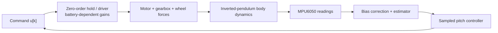

# NANENG 512 — Stage 2 Modeling and Validation Report
## Assembly, System Identification, MATLAB Analysis

**Deadline:** 6 December 2026 — Week 12  
**Status:** methodology and report draft; **no assembly or experiment documented**.

## 1. Purpose and physical evidence

Stage 2 requires a **complete assembled robot**, block diagram and mathematical model (system identification as needed), MATLAB analysis and Stage 2 report. Record the exact hardware configuration first. Attach photos of both board sides, battery/regulators, driver, motor wiring, fuse, sensor orientation, external kill switch, and the actual CAD assembly. Add serial/part IDs and dates. None are attached yet.

## 2. Mechanical parameter register

| Symbol | Physical quantity | Unit | Measurement method | Current value |
|---|---|---|---|---|
| `m` | effective suspended body mass | kg | calibrated scale | **not measured** |
| `l` | vertical COM to axle distance | m | CAD mass properties + balance validation | **not measured** |
| `J` | effective pitch inertia about axle | kg m² | CAD inertia or compound-pendulum test | **not measured** |
| `r` | wheel radius | m | caliper | **not measured** |
| `d` | wheel track width | m | caliper | **not measured** |
| `b` | viscous damping equivalent | N m s/rad | fit to measured response | **not identified** |
| `Ku` | effective command-to-pitch torque | N m per unit u | joint fit after torque tests | **not identified** |
| `V_m` | nominal motor voltage | V | vendor datasheet + multimeter | **not selected** |
| `I_stall` | single motor stall current | A | manufacturer datasheet/test with safety protection | **not known** |

The `matlab/model_and_design.m` script currently uses *demonstration values* only. Never label those values experimental, and do not claim model agreement with physical data.

## 3. Equations and block diagram

The preliminary pitch-only model is explained in [Control Theory](../control_theory.md):

```text
J theta_ddot = m*g*l sin(theta) - b theta_dot - Ku u
x = [theta, theta_dot]^T
A = [0 1; m*g*l/J -b/J], B = [0; -Ku/J]
xd[k+1] = Ad xd[k] + Bd u[k]
```

The control task is to regulate inclination around `theta=0`. For the full robot, document motor current dynamics, gear ratio, wheel torque, chassis displacement and external floor forces. If adding encoder feedback, extend the system state to pitch and longitudinal position/velocity.



## 4. Experiments / dataset protocol (to be conducted)

### 4.1 Sensor bias and angle accuracy
Keep vehicle firmly supported upright with motors unpowered. Log raw accelerometer and gyro at 200 Hz or a measured sample rate, with timestamps. Repeat at known jig inclinations; document errors, spread and calibration drift.

### 4.2 Electrical/power acceptance
Verify correct logic voltage, regulated supply during motor transients, I2C pull-ups, sensor WHO_AM_I, motor supply fuse, physical cutoff, STBY default LOW and current limits. Do not perform unsafe stalled-motor tests without current limit and monitoring.

### 4.3 Motor characterization
With supported frame and low drive, record duty, supply, shaft speed (with encoder/tachometer), driver current and direction for each motor. Determine sign, deadzone and symmetry. Obtain motor manufacturer stall current or safely controlled parameter measurement. Do not assume identical wheel polarity.

### 4.4 Identification/validation split
Collect `dataset_train.csv` and `dataset_validation.csv` with time, angle, angular rate, signed motor command, and additional wheel/battery channels if available. Fit unknown parameters on training data only. Evaluate prediction residuals on validation data using RMS and peak absolute error. Repeat at more than one initial angle.

## 5. MATLAB analysis procedure

1. Load [`model_and_design.m`](../../matlab/model_and_design.m) and distinguish illustrative values from identified values.
2. Build continuous state matrices and `c2d` with **actual measured** sample interval.
3. Check controllability and locations of open/closed-loop poles.
4. Design a controller using discrete feedback gains; simulate small perturbations and constraint saturation.
5. Cross-check simulated and measured pitch using [`plot_telemetry.m`](../../matlab/plot_telemetry.m) when timestamped logs exist.
6. Record sampling jitter, delays, gain robustness and measured amplifier/motor saturation.

The current LQR script is *not* the firmware controller; comparing LQR vs PD/PID without applying identical plant/sampling assumptions would be invalid.

## 6. Results tables to fill after hardware measurement

| Run ID | Initial tilt (deg) | Controller | Angle RMS (deg) | Peak abs tilt (deg) | Settling time (s) | Battery (V) | Evidence file |
|---|---:|---|---:|---:|---:|---:|---|
| *not yet measured* | — | — | — | — | — | — | — |

| Model | Fitted parameters | Train error | Holdout error | Units/notes |
|---|---|---|---|---|
| Pitch-only demo | placeholder values only | N/A | N/A | not validated |

## 7. Discussion and limitations

The ideal state-space model does not include 3D turning, lateral center-of-mass shifts, contact slip, backlash, discrete PWM deadzone, supply sag or complex IMU artifacts. The open-loop inverted-pendulum model alone does not demonstrate full robotic equilibrium. Any concluding performance statements depend on the measurements still to be acquired.

## 8. Required Stage 2 attachments

- [ ] Photographs of safely wired complete assembly
- [ ] Documented final BOM, driver-current checks and drawn schematic
- [ ] Chassis CAD / dimensions and COM estimate
- [ ] Block diagram and measured/identified equations
- [ ] MATLAB source, exported figures and source datasets
- [ ] Plot annotations distinguishing model vs experiment
- [ ] Unit, sample timing and uncertainty analysis
- [ ] Stage 2 report sign-off by the five group members
